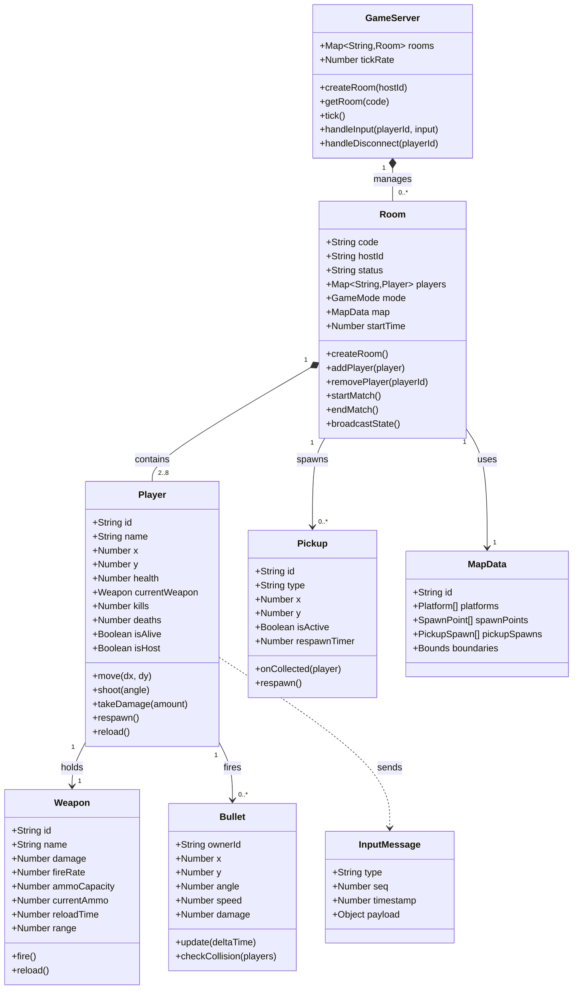
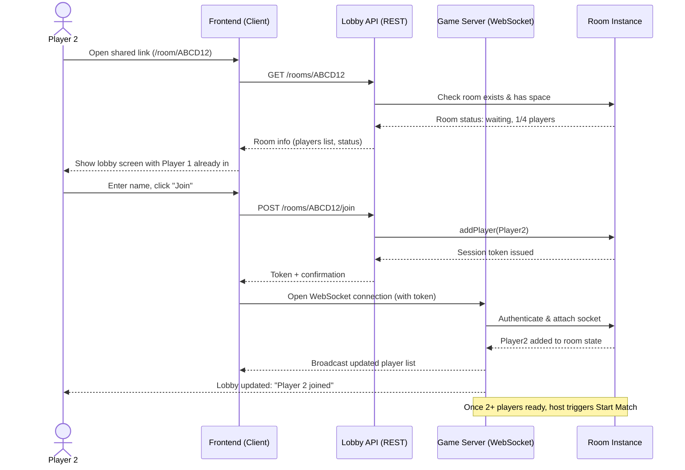
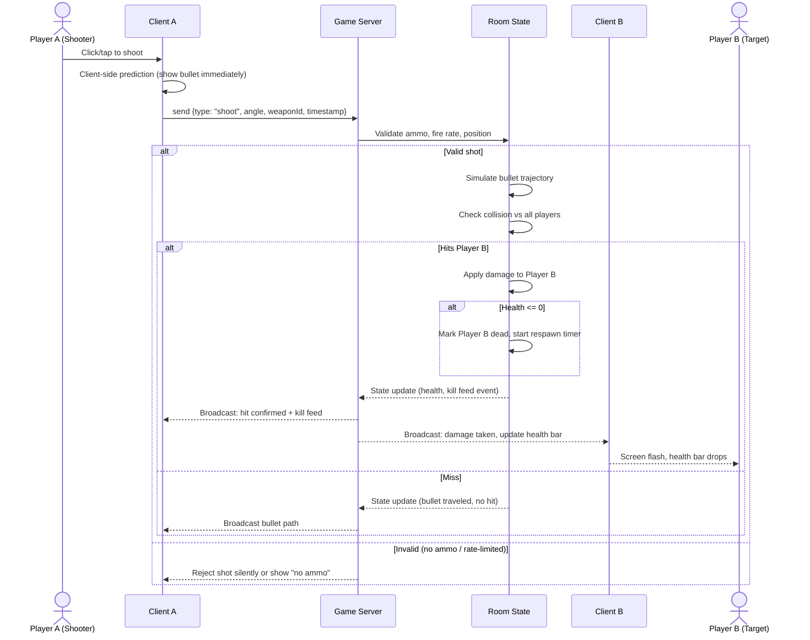
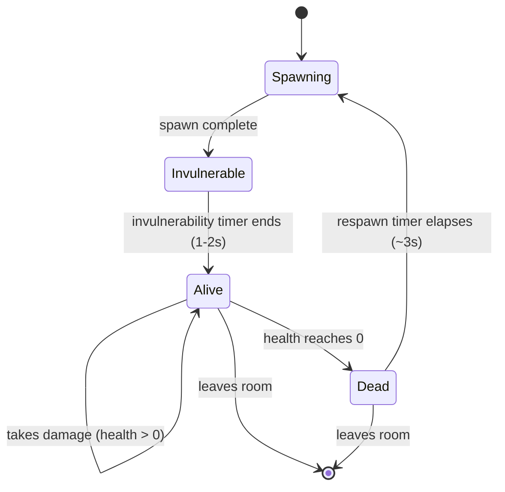
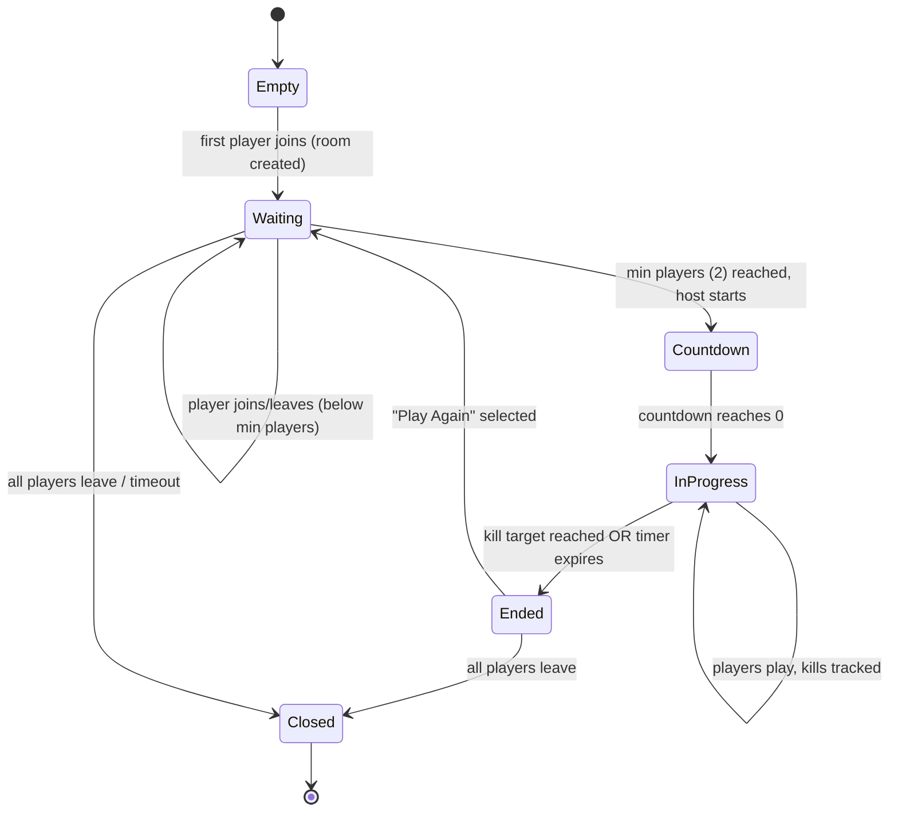
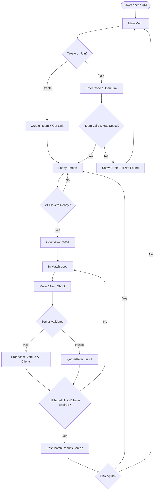
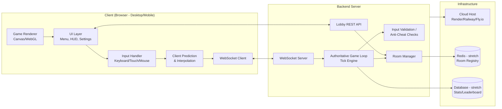
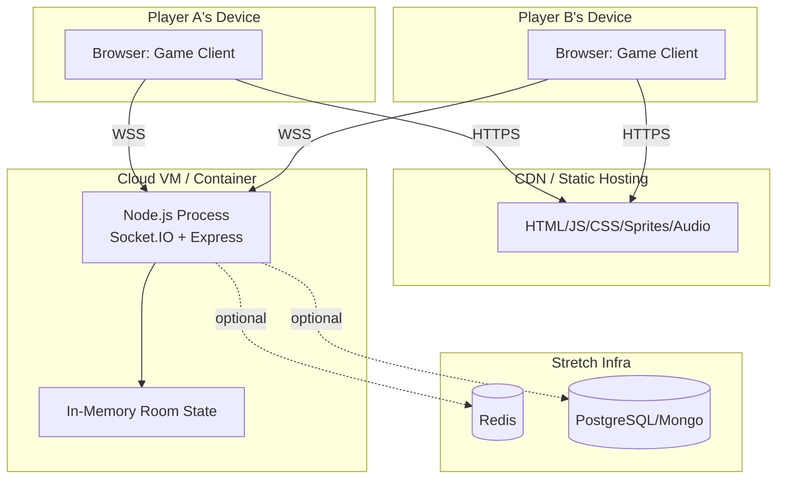

# UML Documentation
### Complete UML diagram set for the multiplayer 2D shooter

This file contains all standard UML diagram types relevant to this project, rendered as Mermaid diagrams (viewable directly in the markdown preview) with explanations for each.

---

## 1. Use Case Diagram
Shows what actors (Player, Host, Server) can do in the system.

```mermaid
graph TB
    Player((Player))
    Host((Host Player))
    Server((Game Server))

    Player --> UC1[Enter Name]
    Player --> UC2[Create Room]
    Player --> UC3[Join Room via Code/Link]
    Player --> UC4[Move Character]
    Player --> UC5[Aim & Shoot]
    Player --> UC6[Reload Weapon]
    Player --> UC7[Collect Pickup]
    Player --> UC8[View Scoreboard]
    Player --> UC9[Respawn After Death]
    Player --> UC10[View Match Results]
    Player --> UC11[Rematch / Leave]

    Host --> UC2
    Host --> UC12[Start Match]
    Host --> UC13[Kick Player - stretch]

    Server --> UC14[Validate Movement/Shots]
    Server --> UC15[Broadcast Game State]
    Server --> UC16[Apply Damage & Death Logic]
    Server --> UC17[Manage Room Lifecycle]
    Server --> UC18[Handle Disconnect/Reconnect]
```

**Key actors:**
- **Player** — any connected client; the primary actor.
- **Host** — the player who created the room; has slightly elevated privileges (start match).
- **Game Server** — a system actor that drives authoritative logic, not a human, but essential to model since it "acts" on every gameplay use case.

---

## 2. Class Diagram
Core domain model — the objects your code will actually be built around, client and server side.

---

## 3. Sequence Diagram — Joining a Room
Shows the message flow when a second player joins via a shared link.

---

## 4. Sequence Diagram — Shooting & Damage (Server-Authoritative)
Shows how a "real rule" (damage) is enforced end-to-end.

---

## 5. State Diagram — Player Lifecycle
Models the "real rules" a player intuitively learns: alive → damaged → dead → respawn.

---

## 6. State Diagram — Room / Match Lifecycle
Models the overall match flow, a "rule" the whole game revolves around.

---

## 7. Activity Diagram — Full Player Journey
End-to-end flow from opening the link to seeing results.

---

## 8. Component Diagram — System Architecture
High-level software components and how they communicate.

---

## 9. Deployment Diagram
Physical/hosting view — where each piece actually runs.

---

## 10. How These Diagrams Map to Your Requirements

| Requirement | Diagram(s) that address it |
|---|---|
| "At least two players from separate devices" | Deployment Diagram, Sequence: Joining a Room, Component Diagram |
| "Real rules a player could follow without explanation" | Player State Diagram, Room/Match State Diagram, Class Diagram (Weapon/Player/Pickup rules baked into structure) |
| "Live at a URL others can reach" | Deployment Diagram, Component Diagram |
| Core gameplay logic (shoot, damage, death) | Sequence: Shooting & Damage, Class Diagram, Activity Diagram |

---

## 11. Notes on Using These Diagrams

- These are **design-level** UML — intended to guide implementation, not to be exhaustively complete before you write code. Expect the Class Diagram especially to evolve once you start building.
- The **Class Diagram** is client/server agnostic here — in practice, you'll likely have a server-side authoritative version of `Player`/`Room`/`Bullet` and a lighter client-side rendering counterpart; split that once implementation starts.
- All diagrams render natively wherever GitHub-flavored Markdown + Mermaid is supported (GitHub, many IDEs, Notion, this chat's markdown preview).
